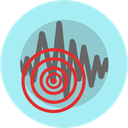

<div align="center">


<a href="https://github.com/ExpTechTW"></a>
<a href="https://huggingface.co/YuYu1015"></a>
<a href="https://exptech.com.tw/dc"></a>
<a href="https://www.instagram.com/whes1015"></a>
<a href="https://www.threads.net/@whes1015"></a>

</div>

## 👋 關於我

```go
package main

type Developer struct {
	Age       int
	Birthday  string
	School    string
	Interests []string
	Founder   string
	Currently string
	Goal      string
}

var YuYu1015 = Developer{
	Age:       23,
	Birthday:  "2003/10/15",
	School:    "國立高雄科技大學 (NKUST) · 電機工程系 ⚡",
	Interests: []string{"電子電路", "程式設計"},
	Founder:   "ExpTech | 探索科技",
	Goal:      "成為專業的全端工程師 💪",
}
```

<table>
  <tr>
    <td align="center" width="33%">🤝<br><b>中央氣象署 簽約合作</b><br><sub>2022 · CWA</sub></td>
    <td align="center" width="33%">🎤<br><b>DevFest Taipei 講者</b><br><sub>2024 · Google Developer Groups</sub></td>
    <td align="center" width="33%">📰<br><b>14 家媒體報導</b><br><sub>2024 · DPIP</sub></td>
  </tr>
</table>

## 📝 主要作品

<table>
  <tr>
    <td valign="top" width="50%">
      <h3><a href="https://github.com/ExpTechTW/TREM-Lite"> TREM-Lite</a></h3>
      <p>
        
        
      </p>
      <p>臺灣即時地震監測。</p>
      <details>
        <summary><b>技術細節</b></summary>
        <ul>
          <li><b>資料整合</b>：整合 TREM-Net（臺灣即時地震觀測網）和中央氣象署的資料，提供即時且準確的地震資訊。</li>
          <li><b>使用者介面設計</b>：設計直觀且易於使用的介面，提升使用者體驗。</li>
        </ul>
      </details>
    </td>
    <td valign="top" width="50%">
      <h3><a href="https://github.com/ExpTechTW/DPIP"> DPIP</a></h3>
      <p>
        
        
      </p>
      <p>Disaster Prevention Information Platform — 由臺灣本土團隊設計的防災資訊整合平台，提供即時的地震速報與災害資訊，協助使用者在災害發生時迅速應對。</p>
      <details>
        <summary><b>技術細節</b></summary>
        <ul>
          <li><b>跨平台開發</b>：使用 Flutter 框架進行跨平台開發，確保應用程式在 iOS 和 Android 平台上的一致性和高效能表現。</li>
          <li><b>資料整合</b>：整合 TREM-Net（臺灣即時地震觀測網）和中央氣象署的資料，提供即時且準確的地震資訊。</li>
          <li><b>狀態管理</b>：採用 Provider 進行狀態管理，提升應用程式的可維護性和效能。</li>
          <li><b>即時通知</b>：實現即時推播功能，讓使用者在地震發生時能夠立即收到警報。</li>
          <li><b>使用者介面設計</b>：設計直觀且易於使用的介面，提升使用者體驗。</li>
        </ul>
      </details>
    </td>
  </tr>
</table>

> [!TIP]
> 🤗 在 Hugging Face 量化了不少模型，快來看看吧 → [YuYu1015](https://huggingface.co/YuYu1015)

## 🛠️ 技術能力

| 類別 | 技術 |
|:---:|:---|
| 💻 程式語言 |  |
| 🔧 框架 |  |
| 🗄️ 資料庫 & DevOps |  |
| ☁️ 雲端服務 |  |
| 🔌 開發板 | <br><sub>Arduino Uno · Nano｜ESP32 · ESP8266｜Raspberry Pi 4B · Pico</sub> |
| 🎮 遊戲開發 |  |

## 🗺️ 里程碑

<details>
<summary><b>🌱 創立 & 合作</b> · 6</summary>

| 日期 | 成就 |
|:---|:---|
| `2020/10/15` | 建立 **[ExpTech \| 探索科技](https://github.com/ExpTechTW)** |
| `2022/05/31` | 首次與 **高中學校合作（臺南 大灣高中）** 部署自製 `加速度型地震儀` |
| `2022/12/12` | 與 **交通部中央氣象局（CWB）** 簽約合作 |
| `2022/12/17` | 首次與 **國中學校合作（臺東 池上國中）** 部署自製 `加速度型地震儀` |
| `2023/02/07` | 至 **中央研究院（臺灣地震科學中心）** 分享 `TREM` 開發過程 |
| `2023/04/09` | 首次與 **大學學校合作（花蓮 東華大學）** 部署自製 `速度型地震儀` |

</details>

<details>
<summary><b>💼 工作經歷</b> · 3</summary>

| 期間 | 單位 | 職稱 |
|:---|:---|:---|
| `2026/03 ～ 現在` | **STAR 學生火箭團隊** | `網路支援組` |
| `2025/01 ～ 現在` | **國家衛生研究院** | `程式開發` |
| `2024/12 ～ 2025/06` | **中央研究院 資訊科學研究所** | `兼任助理` |
| `2023/11 ～ 2024/11` | **衛波科技股份有限公司** | `後端工程師` |

</details>

<details>
<summary><b>🏆 競賽 & 獲獎</b> · 7</summary>

| 日期 | 成就 |
|:---|:---|
| `2023/04/05` | `TREM` 在 `桃園市第63屆中小學科學展覽會` 獲得 `地球與行星科學科` **縣市第一名** |
| `2023/07/28` | `TREM` 在 `第63屆全國中小學科學展覽會` 獲得 `地球與行星科學科` **全國第二名** |
| `2024/07/10` | 參加 `2024 MAIC 行動應用創新競賽` |
| `2024/11/09` | DPIP 獲得 **防災傑出獎** |
| `2025/04/20` | `2025 技職杯 黑客松 南區賽` 獲得 **最佳技術獎** |
| `2025/05/26` | `2025 技職杯 黑客松 全國賽` 獲得 **最佳設計獎** |
| `2026/05/10` | `2026 技職杯 黑客松 南區賽` 獲得 **最佳創意獎** |

</details>

<details>
<summary><b>🎤 活動 & 演講</b> · 12</summary>

| 日期 | 成就 |
|:---|:---|
| `2023/11/07` | 以 **ExpTech - Team Leaders** 身份受邀參加 `中央氣象署(CWA) 112年合作推動地震資訊傳遞服務成果交流會` |
| `2024/01/25` | 參加 **中央研究院 2024 Earthquake Early Warning workshop** 並與 `京都大學 山田真澄 老師` 分享 TREM 開發過程 |
| `2024/10/26` | 參加 `OCF 秋季交流會` |
| `2024/11/14` | `臺灣教育科技展` 講者（受 `ViewSonic` 邀請） |
| `2024/11/14` | 全球數位人權大會 `RightsCon 25 Taipei` 前導介紹會 |
| `2024/11/23` | 參加 `g0v 第64次 黃金比例黑客松` |
| `2024/11/30` | `Google Developer Groups DevFest Taipei 2024` **講者** |
| `2025/03/04` | `TOOCON #27` **講者** |
| `2025/03/08` | 參加 `SITCON 2025` |
| `2025/08/09` | 參加 `COSCUP 2025` |
| `2025/11/30` | `Google Developer Groups DevFest Taipei 2025` 開發組 志工 |
| `2026/03/28` | 參加 `SITCON 2026` |
| `2026/10/17` | 參加 `PyCon TW 2026` **Young Inspires 講者** |

</details>

<details>
<summary><b>👨‍🏫 教學</b> · 4</summary>

| 日期 | 成就 |
|:---|:---|
| `2024/10/25`、`2024/11/01`、`2024/11/08` | 至 `國立雲林科技大學` 教授 `Arduino` |
| `2024/10/26` | 至 `高雄市立中正高級工業職業學校` 教授 `Arduino 循跡避障` |
| `2025/08/16` | 至 `高雄市立中正高級工業職業學校` 教授 `視覺辨識 自走車` |
| `2026/05/23` | 至 `高雄市立中正高級工業職業學校` 教授 `人工智慧` |

</details>

<details>
<summary><b>📰 媒體報導</b> · 14</summary>

| 日期 | 成就 |
|:---|:---|
| `2024/04/24` | DPIP 獲得 `三立新聞` 報導 |
| `2024/04/24` | DPIP 獲得 `民視新聞` 報導 |
| `2024/04/24` | DPIP 獲得 `華視新聞` 報導 |
| `2024/04/24` | DPIP 獲得 `奇摩新聞` 報導 |
| `2024/04/25` | DPIP 獲得 `ETtoday新聞雲` 報導 |
| `2024/04/25` | DPIP 獲得 `TVBS NEWS` 報導 |
| `2024/04/25` | DPIP 獲得 `今日新聞` 報導 |
| `2024/04/26` | DPIP 獲得 `聯合新聞網` 報導 |
| `2024/04/26` | DPIP 獲得 `中央社 CNA` 報導 |
| `2024/05/06` | DPIP 獲得 `Hami書城` 報導 |
| `2024/07/23` | DPIP 獲得 `親子天下` 報導 |
| `2024/07/29` | DPIP 獲得 `國立中央大學 新聞網` 報導 |
| `2024/08/15` | DPIP 獲得 `LINE TODAY` 報導 |
| `2024/08/23` | DPIP 獲得 `天下雜誌` 報導 |

</details>

## 📊 GitHub 統計

<div align="center">


</div>


